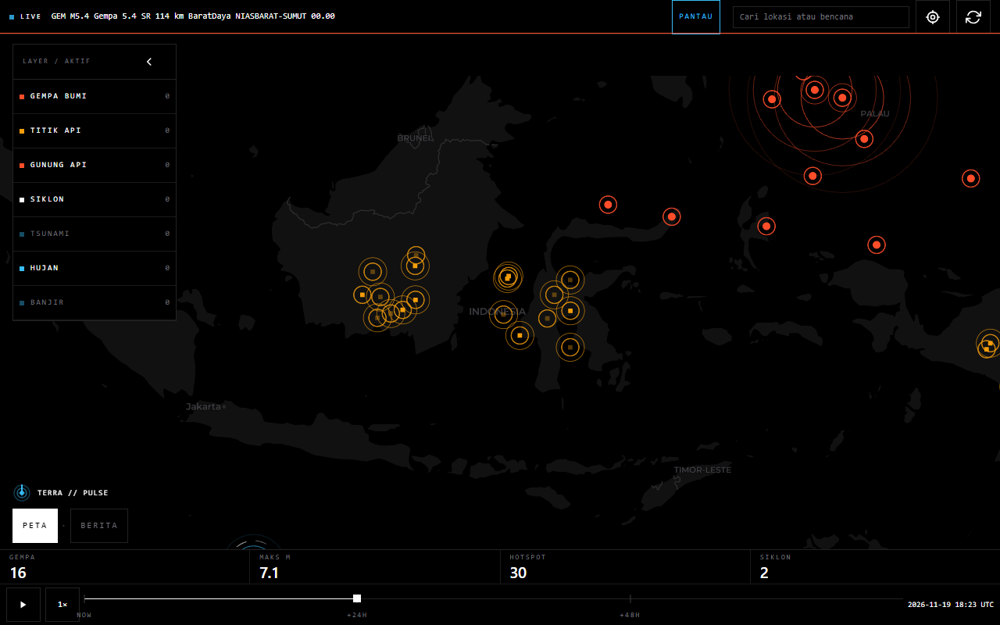
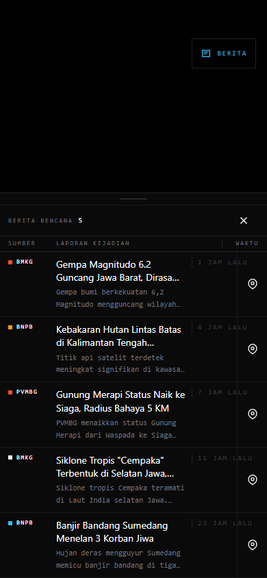
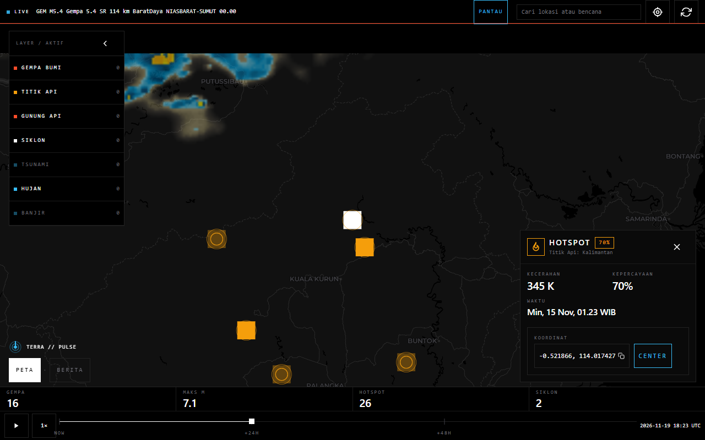

<p align="center">
  
</p>

# TerraPulse

Radar bencana dan cuaca real-time ringan untuk desktop dan mobile (PWA). Peta gelap menampilkan gempa, gunung api, titik panas kebakaran hutan, risiko banjir, dan simulasi tsunami/cyclone dalam satu layar WebGL.

Fokus utama: responsif di smartphone, tetap ringan di perangkat low-end, dan tidak bergantung pada layanan peta berbayar.

## Fitur

- **Peta WebGL** — MapLibre GL + deck.gl dengan basemap CartoDB dark-matter (tanpa token Mapbox/Google).
- **Layer bencana** — gempa (BMKG/USGS), gunung api (PVMBG), titik panas (NASA FIRMS), banjir, dan berita terkait.
- **Simulasi tsunami** — isochrone 15 menit berdasarkan `v = sqrt(g * h)` (default `h = 4000 m` → ~713 km/h), otomatis untuk gempa bawah laut `M >= 6.5` dan kedalaman `<= 70 km`, atau lewat toggle manual di kartu event.
- **Playback angin & siklon** — timeline -24h sampai +48h (langkah 3 jam), partikel angin dan zona konvergensi tekanan rendah.
- **HUD adaptif** — panel kaca desktop, pill filter + bottom sheet di mobile, scrubbing timeline, dan tombol "Near Me" dengan jarak Haversine.
- **Throttling otomatis** — partikel dibatasi 1500 di mobile/low-core vs 5000 di desktop, DPR dibatasi maksimal 2.
- **Tahan gagal** — setiap route API punya fallback; peta tidak pernah crash saat feed eksternal mati. Response selalu menyertakan metadata `source`, `cached`, `stale`, dan `timestamp`.

## Preview

| Desktop (1280×800) | Mobile (390×844) |
| --- | --- |
|  |  |

<p align="center">
  
</p>

## Stack

Next.js 15 (App Router), TypeScript strict, Tailwind CSS, maplibre-gl, deck.gl v9, React Hooks + `fetch`, Vitest + Playwright.

## Menjalankan

```bash
pnpm install
pnpm dev
```

Buka http://localhost:3000.

Opsional: tambahkan `NASA_FIRMS_MAP_KEY` untuk data titik panas NASA FIRMS asli. Tanpa key, route `/api/hotspots` memakai generator mock dan menandainya di metadata.

```bash
# .env.local
NASA_FIRMS_MAP_KEY=...
```

## Script

| Perintah | Fungsi |
| --- | --- |
| `pnpm dev` | Dev server |
| `pnpm build` | Build produksi |
| `pnpm start` | Jalankan build produksi |
| `pnpm lint` | ESLint |
| `pnpm typecheck` | `tsc --noEmit` |
| `pnpm test:unit` | Vitest |
| `pnpm test` | Playwright (butuh dev server jalan) |

## Sumber data

| Endpoint | Sumber utama | Fallback |
| --- | --- | --- |
| `/api/earthquakes` | BMKG | USGS → data cache/stale |
| `/api/hotspots` | NASA FIRMS VIIRS | Mock hotspots |
| `/api/volcanoes` | PVMBG MAGMA | Smithsonian / mock |
| `/api/weather` | RainViewer + Open-Meteo | Grid angin mock |
| `/api/news` | BMKG, BNPB, PVMBG (RSS) | Berita mock |

Semua feed dinormalisasi jadi `DisasterFeatureCollection` (GeoJSON) di server, dengan cache `revalidate` 60–600 detik. Lihat [`AGENTS.md`](./AGENTS.md) untuk kontrak data dan aturan arsitektur, serta [`DESIGN.md`](./DESIGN.md) untuk token desain.

## Struktur

```
src/app/api/     # Route handlers + normalisasi external feed
src/components/map/    # MapLibre, deck.gl layer, simulasi
src/components/hud/    # Panel layer, kartu event, timeline, berita
src/hooks/       # Deteksi kapabilitas perangkat
src/lib/         # geoMath, normalizers, fetch helper
src/types/       # Skema GeoJSON & state HUD
public/          # manifest PWA + service worker
```
